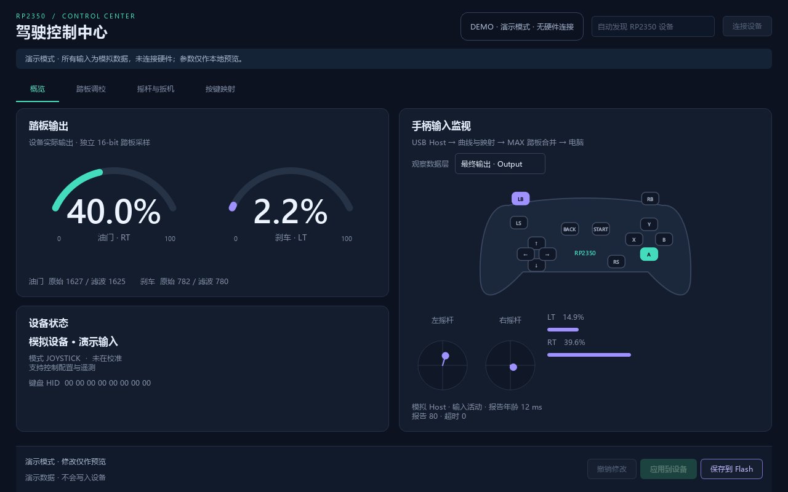

# 基于 RP2350 的赛车模拟器油门与刹车

**下载：[v0.4.0 预发布版](https://github.com/yk23311/rp2350-racing-pedals/releases/tag/v0.4.0)**，包含普通/诊断UF2、含GUI的源码包、快速说明与SHA256。软件测试通过，仍待实机验收；GUI源码包需Python环境。

**新版驾驶控制中心已实现**：自动识别串口，实时踏板百分比、手柄按键/摇杆/扳机监视，踏板和手柄曲线预览与调参，手柄按钮→手柄/键盘映射。双击根目录 **启动调参GUI.bat**，详见[一步步使用说明](docs/control-center.md)。

完整功能需要新版`dist/host/pedals-host.uf2`（0.4.0-control-center）。Type-C接电脑，2.4G接收器插板卡USB-A，GP26/27踏板保持原接线；曲线和映射在板端执行，关闭GUI仍有效，不依赖Steam或电脑虚拟手柄。新版已构建，**尚未烧录或实机验收**。

旧固件可继续调踏板；手柄遥测和配置会明确显示不支持。新固件能迁移读取旧PDL1校准；显式保存后使用PDL2，旧固件不能读取新格式，降级前请备份校准。下文旧HID/Tk内容作为历史与兼容路线保留，最新入口为[HANDOFF.md](HANDOFF.md)。

**当前传感器仅确认 5V 供电，输出类型和电压未知。先按 [硬件接入说明](docs/hardware.md) 测量，不能直接把未知信号接到 GP26/GP27。** 未校准默认输出中立。

## 从 GitHub 首次使用

本仓库包含源码、测试、文档与界面演示图，不上传本地工具链、`.venv`、`build`、`deps`或`dist`。面向Windows与微雪RP2350-USB-A开发板；没有硬件也能预览GUI。

```powershell
python -m venv .venv
.\.venv\Scripts\python.exe -m pip install -r tools/requirements.txt
powershell -ExecutionPolicy Bypass -File tools/start_gui.ps1 -Demo
```

实际连接时去掉`-Demo`。完整手柄遥测、曲线和映射需要本地按下文构建并烧录桥接固件，GUI不会自动烧录。界面如下（演示数据）：



## 工程入口

- [方案审核与来源](docs/reports/01-review.md)
- [首版设计](docs/superpowers/specs/2026-10-30-pedals-design.md) / [实施计划](docs/superpowers/plans/2026-10-30-pedals-plan.md)
- [步骤及交接报告总表](docs/reports/00-handoff.md)
- [硬件说明](docs/hardware.md) / [验收步骤](docs/validation.md) / [CDC协议](docs/protocol.md)

目录：`src/core/` 纯C算法、记录格式、控制台、USB报告布局与中立屏障；`firmware/` Pico HAL、Flash、TinyUSB、主循环；`tools/` 构建、CLI、GUI；`tests/` PC验证。

## 电脑端测试

Windows 已安装 Visual Studio C++/Clang、CMake、Ninja 和 Python 时：

```powershell
powershell -ExecutionPolicy Bypass -File tools/build_host.ps1
```

其他平台也可用原生C编译器运行：

```sh
cmake -S . -B build/host -DCMAKE_BUILD_TYPE=Release
cmake --build build/host
ctest --test-dir build/host --output-on-failure
python -m unittest discover -s tests -p 'test_*.py' -v
```

## 构建固件（Windows）

```powershell
python tools/fetch_deps.py
powershell -ExecutionPolicy Bypass -File tools/build_firmware.ps1 -UsbMode host
```

依赖只下载至项目 `deps/`：Pico SDK 2.2.0、其锁定的 TinyUSB、Arm GNU 14.3.rel1。下载较大；需要联网。脚本打印 SHA256 供记录，但不等于验证上游数字签名。桥接构建输出 `dist/host/pedals-host.*`；不传`-UsbMode host`时脚本仍默认构建独立踏板`dist/xinput/pedals-xinput.*`；`-UsbMode hid`输出 `dist/hid/pedals-hid.*`。UF2使用 SDK定义的 RP2350 ARM-S family，不自动烧录。

Windows Arm链接器在本项目中文路径下无法解析其标准库；脚本临时使用空闲R:映射本项目，完成或失败后移除。R:已被占用时可传入 `-DriveLetter S`；不会覆盖现有盘符，也不移动工程。构建缓存分为 `build/firmware-xinput-R/` 与 `build/firmware-hid-R/`。

Flash配置保留区：`0x101FE000` 和 `0x101FF000` 两个4KiB扇区；正常程序链接区不覆盖该区域。更新固件通常保留配置；整片擦除会清空。

## 上板后调参

项目已准备好独立的 `.venv` 串口环境；GUI 使用 Python 自带的 Tkinter，无需 PyQt。

**最简单的启动方式：双击项目根目录的 `启动调参GUI.bat`。** 也可以在 PowerShell 中运行：

```powershell
powershell -ExecutionPolicy Bypass -File tools/start_gui.ps1
```

只想检查环境而不打开窗口：

```powershell
powershell -ExecutionPolicy Bypass -File tools/start_gui.ps1 -Check
```

移交到新电脑时先执行 `python -m venv .venv`，再执行 `.\.venv\Scripts\python.exe -m pip install -r tools/requirements.txt`。CLI也使用该虚拟环境的Python；下列示例运行前可执行 `.\.venv\Scripts\Activate.ps1`，或把 `python` 换成 `.\.venv\Scripts\python.exe`。

输入设备管理器中确认的串口号。滑条调节后点“应用参数”在 RAM 生效；松开两踏板并回零后点“保存到 Flash”。两轴分别执行“全松开：开始校准”→“踩到底并保持：完成”，每个位置至少保持100ms再操作。

也可使用CLI（以下COM5仅作示例）：

```powershell
python tools/pedalctl.py --port COM5 get
python tools/pedalctl.py --port COM5 calibrate 0
python tools/pedalctl.py --port COM5 calibrate 1
python tools/pedalctl.py --port COM5 set 1 --on 300 --off 100 --gamma 200 --window 4
python tools/pedalctl.py --port COM5 save
python tools/pedalctl.py --port COM5 export pedal-config.json
python tools/pedalctl.py --port COM5 monitor --seconds 3600 --interval 0.1 --output aging.csv
```

`on/off`单位为万分之一（300=3%），`gamma`单位为百分之一（200=2.00）。`SAVE`返回状态错误时先松开两踏板、结束校准、等待中立报告完成再重试；不能视作已经保存。CSV为电脑轮询数据，默认10Hz，不是全部1kHz ADC样本。

## 已明确的限制

- 当前为开发验证版本；实机验收记录见交接总表。标准HID不等于XInput，按目标游戏验证兼容性。
- 开发 VID/PID 为 `CAFE:4011`，不作为正式分配的产品身份；发布硬件前需获得合适的USB身份并复验描述符。
- 固件声明最大100mA USB总电流，连接传感器前确认整板与传感器总需求；不在此供电预算内接电机。
- 屏幕菜单、方向盘、触觉反馈和复杂宏未实现，属于后续扩展。
