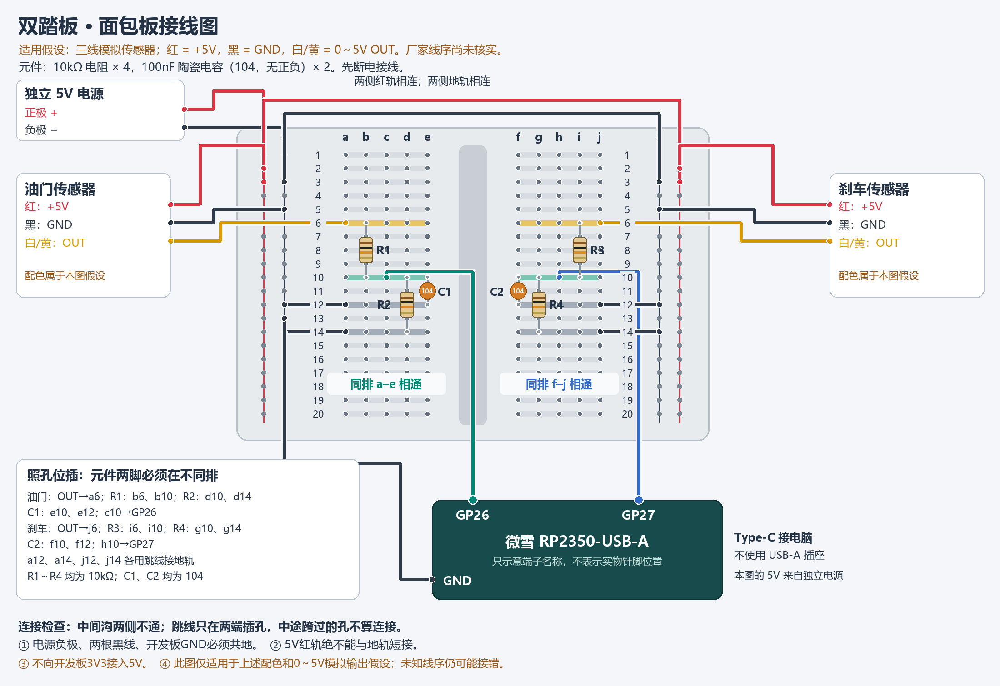

# 双踏板面包板图：条件试接

配色仍为假设：红=+5V、黑=GND、白/黄=0～5V模拟输出。传感器型号、线序、电流和输出类型没有确认，此图不把假设升级为已核实接线。与此前12k/15k计算候选不同，本图使用每路10k/10k等比分压，便于面包板搭建；它仍以0～5V低阻模拟输出为前提。

先断电；图中独立5V电源仅供传感器，开发板使用Type-C连接电脑，两者共地。开发板画成逻辑端子，实物按GP26、GP27、GND丝印查找，不能照图中端子相对位置猜针脚。

| 项目 | 油门（左侧a–e） | 刹车（右侧f–j） |
|---|---|---|
| 信号输入 | a6 | j6 |
| 上电阻10kΩ两脚 | b6、b10 | i6、i10 |
| 下电阻10kΩ两脚 | d10、d14 | g10、g14 |
| 100nF陶瓷电容两脚 | e10、e12 | f10、f12 |
| ADC跳线 | c10→GP26 | h10→GP27 |
| 地跳线 | a12、a14分别到地轨 | j12、j14分别到地轨 |

同排a–e内部相通，同排f–j内部相通，沟两侧隔离。红轨与地轨是独立导体。只使用电源轨上半部分；如果你的面包板轨道存在断点，应保证所用各孔实际连通。图中每个孔只安排一个元件脚或跳线端点。

图为确定孔位的程序绘图：`tools/draw_breadboard.py`。每路理想分压为1/2，0～5V变为0～2.5V；10k/10k等效电阻5kΩ，100nF时间常数约0.5ms，截止频率约318Hz。未进行实物搭建或测量。
