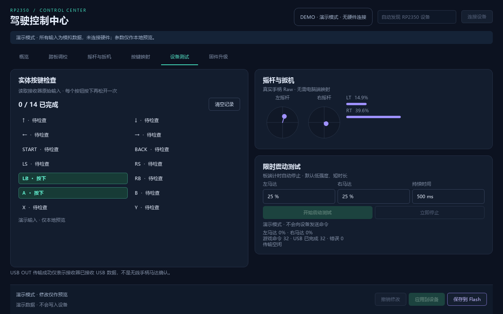
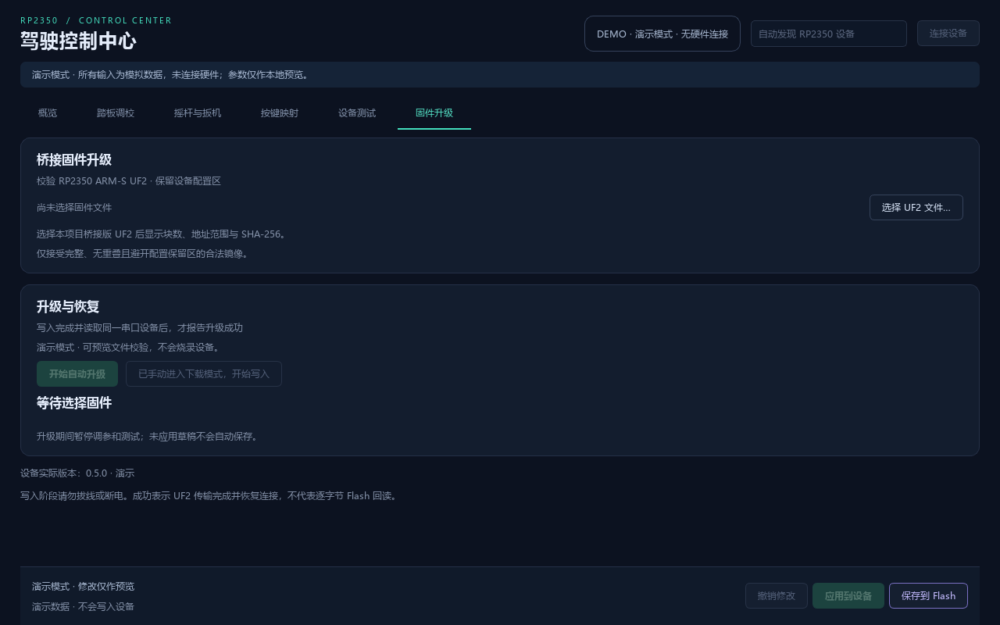

# 18：GUI 按键测试、限时震动与一键升级

日期：2026-11-05，Asia/Shanghai。用户已确认设计后实施。版本 **0.5.0-device-tests-updater**，包含上一阶段尚未发布的 0.4.1 震动转发修复。代码在 `codex/gui-tests-updater`；本次没有自动烧录或上传 Release。

## 交付结果

原四页保留，新增“设备测试”“固件升级”。双击根目录 `启动调参GUI.bat` 使用新界面。详细步骤见[使用说明](../control-center.md)。

- **按键测试**：读取真实接收器原始十四键，按下高亮，按下再松开记为已完成；清空记录可重测。断连、过期和被阻塞的 GUI 事件循环不会把旧动作判为松开；新连接清空记录。同步显示真实摇杆和 LT/RT。
- **震动测试**：左右马达独立 0–100%，100–3000ms，默认 25%、500ms；板端到时停震。立即停止不受普通队列容量限制，会清理之前待执行的测试，保留配置操作；当前串口请求结束后优先停震。游戏震动在测试期间忽略，结束后只处理新命令。显示中文强度、剩余时间及错误/传输计数。
- **一键升级**：完整校验 UF2，再由同一串口线程请求 BOOTSEL、释放串口、等待下载盘、写入、验证同一序列号应用恢复并重读状态。只有这时才显示完成与设备实际版本。旧固件可在本次 GUI 先记录身份后使用手动 BOOT 写入入口；首次也可按传统复制 UF2 安装。

## 步骤报告

### 1. 板端命令和停震

增加严格解析的 `RUMBLE TEST l r ms`、`RUMBLE STOP`；`RUMBLE` 增加 `testing/remaining_ms`，`CAPS` 增加 `rumble_test/bootsel`。软件计时与 GUI 无关，接收器失联、USB 挂起、校准/模式变化沿用原停止和故障预算。保留实际 OUT 端点解析、稳定缓冲、100ms abort、20ms 退避和停止优先。

新增 `BOOTSEL`，先强制手柄和键盘中立、停止马达，原始回复获 CDC 完成确认后至少等 300ms，最多等 1.5s 停止/中立，然后调用 SDK `rom_reset_usb_boot(0,0)`。确认丢失超过 1.5s 则取消 pending 并恢复命令，不让设备一直停在升级等待；升级等待时后续修改被拒绝。

先添加 Host 定时及回绕、命令非法范围、升级中立、ACK 丢失和 ACK 延迟测试并观察失败，再实现/修复到通过。真实 `usb.c/host.c` 在 PC mock 中编译执行，仍不是实物验收。

### 2. 升级器与串口生命周期

新增 `tools/firmware_update.py`，只接受本项目连续 256 字节 payload 格式：完整魔数、flag `0x2000`、family `0xE48BFF59`、序号/总数无重复或缺失、从 `0x10000000` 连续写入且末地址不超过 `0x101FE000`。读取有上限，校验后的不可变字节用于传输，文件选择后被替换会再次校验。

Windows 下载盘通过 `INFO_UF2.TXT` 的精确 `Board-ID: RP2350`、卷 GUID、卷序列号和 INFO 哈希识别。自动模式忽略已有卷，多个新匹配卷拒绝；盘符变化不把旧卷当新设备。最终写入使用捕获的卷 GUID 路径，避免盘符在检查和打开文件之间被重新分配。

Session 仍独占全部串口 IO；升级独占期间不接受调参/保存/测试，不自动保存草稿，重连不重放命令。写入之前可取消，开始写入后禁止关窗中断。失败不会自动再写。升级终态使用独立的有界消息通道，即使随后串口 epoch 变化，也能恢复 GUI 操作；释放升级门控和发布终态同步完成。

### 3. 界面与可视检查

新增聚焦控件模块 `tools/control_test_pages.py`，主窗口只接入数据和动作。演示模式明确标注模拟且不访问硬件；旧固件按能力禁用测试和自动升级。原四页及新增两页检查 1280×800、900×650；设备测试页压缩布局保证常用动作和状态可见。

截图均为演示数据：

### 4. 独立审查与修正

两位独立审查者分别检查板端和 GUI/升级器。已修复并补回归：原始升级确认丢失/延迟；无 watchdog 间隔导致的按键误松开；串口失败丢失升级终态；终态已显示但重试门控仍占用；满队列停止被拒绝和旧测试后续重启；卷路径打开竞态和已有卷换盘符误识别。最终复核没有尚未修复的确定问题。

## 验证记录

- 最终完整检查：**58 项 CTest、109 项 Python 测试通过**，见[测试日志](logs/gui-tests-updater-tests.txt)。
- 普通和诊断固件均构建成功，见[普通构建](logs/gui-tests-updater-build.txt)、[诊断构建](logs/gui-tests-updater-debug-build.txt)。GUI 启动环境 Check 通过。
- 所有 manifest 中的 bin/elf/map/uf2 大小和 SHA-256 已重新核对，UF2 通过新校验器；链接末地址普通 `0x100135c8`、诊断 `0x10013a78`，均远低于配置区。

| 本地交付文件 | 字节 | SHA-256 |
|---|---:|---|
| `dist/gui-upgrade/pedals-bridge-v0.5.0.uf2` | 158720 | `520610b6c04c9cfe11866e54a02cab0bea8b7ee4f7af4c8dce44156314f5f947` |
| `dist/gui-upgrade/pedals-bridge-debug-v0.5.0.uf2` | 161280 | `59d958cbf49242f85a18338bd30a0f51eff716b60d43cdf7933c75da2db6b5a0` |

目录另有普通/诊断 manifest、使用说明和 SHA256SUMS。manifest 记录构建当时 HEAD/dirty，`flashed=false`、`board_tested=false`。不要把模拟测试、窗口截图或旧实物日志当作新固件已验收。

## 交接报告：用户下一步

1. 关闭原 GUI，按住 BOOT 重插板卡，将普通 `pedals-bridge-v0.5.0.uf2` 复制到 RP2350 下载盘，等待自动重启。接收器仍插板 USB-A，Type-C 连接电脑。
2. 打开新 GUI，确认设备报告 0.5.0，所有输入释放回中。依次验证十四键按下/松开、摇杆及 LT/RT；数据过期时不应继续记动作。
3. 退出游戏，左右马达分别以 25%、500ms 测试，再测试 3000ms 时中途“立即停止”；关闭 GUI 后测试应在板端截止时结束。USB 计数并不能替代实际震感。
4. 验证配置保存及断电保留，再在 GUI 选择相同普通 UF2 做一次完整自动升级，检查进入下载盘、卷路径写入、同一序列号恢复、校准/映射保留。此 ROM/Windows 路径目前仅模拟验证。
5. 再做同一手柄槽位的转向+油门/刹车、游戏震动、接收器断线/回连和 FH6 游戏验收。GitHub 仍为 v0.4.0 预发布，不要称本版已发布。

若升级失败：按 BOOT 重插并手动复制普通 UF2 恢复。没有先连接过应用而 GUI 不知道设备身份时，使用传统文件复制完成首次安装；不绕过身份限制自动选择另一块板卡。

## 实现依据

UF2 结构依据 [Microsoft UF2 规范](https://github.com/microsoft/uf2)；ROM 重启使用 [Pico SDK bootrom 文档](https://www.raspberrypi.com/documentation/pico-sdk/runtime.html) 并核对本地 SDK2.2.0；卷路径使用 [Microsoft Volume GUID 文档](https://learn.microsoft.com/en-us/windows/win32/fileio/naming-a-volume)。RP2350 下载盘 Board-ID 默认值核对官方 RP2350 datasheet。SDK/TinyUSB 版本沿用项目固定依赖，没有引入电脑输入转换。
